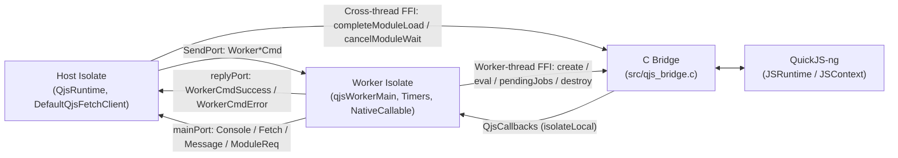

# Architecture Guide (`qjs_dot`)

This document describes the internal architecture of `qjs_dot` for contributors, maintainers, and security/memory auditors.

## 1. Isolate & Threading Model

`QjsRuntime` isolates all QuickJS-ng (`v0.18.0`) execution inside a dedicated Dart `Isolate` (`qjsWorkerMain` in `lib/src/worker_isolate.dart`) so heavy JavaScript execution never blocks the Flutter UI isolate.

### Key Invariants

- **Single-thread engine ownership:** `QjsEngine*` (`JSRuntime*` + `JSContext*`) is created, evaluated, drained, and destroyed exclusively on the Worker Isolate thread.
- **Two-port Dart IPC:**
  - `_replyPort` carries 1:1 RPC responses (`WorkerCmdSuccess` / `WorkerCmdError`) matched by `cmdId`.
  - `_mainPort` carries unsolicited worker-to-host events (`WorkerConsoleEvent`, `WorkerMessageRequest`, `WorkerFetchRequest`, `WorkerModuleLoadRequest`).
- **`NativeCallable.isolateLocal` lifetime:** C callbacks in `QjsCallbacks` invoke Dart functions synchronously on the Worker Isolate thread. `cleanupNative()` in `qjsWorkerMain` destroys the `QjsEngine` *before* closing those `NativeCallable`s so QuickJS-ng cannot call a closed trampoline during teardown.

---

## 2. Asynchronous Execution & Dual Timeouts

### Promise & Microtask Settlement

1. `qjs_dot_eval()` compiles and evaluates the script or ES module, then drains all synchronous microtasks via `qjs_drain_pending_jobs()` (`JS_ExecutePendingJob`).
2. If `async_eval_id > 0` and the result is an unsettled `Promise` (or a custom object with a callable `.then` method), `qjs_attach_async_promise()` attaches `__qjs_dot_attach_promise(...)` and returns `pending_async = 1`.
3. When Dart timers (`Timer` / `Timer.periodic`), `sendMessage()`, or `fetch()` resolve later, `qjsWorkerMain` calls into JS (`__qjs_dot_fire_timer`, `__qjs_dot_resolve_message`, `__qjs_dot_resolve_fetch`) and immediately calls `drainPendingJobs()` (`qjs_dot_execute_pending_jobs`).
4. Once the Promise settles, `__qjs_dot_attach_promise` calls `__qjs_dot_eval_settled`, which triggers `onEvalSettledCb` and resolves the host `Future`.

### Dual Timeout Guard

Because synchronous CPU loops keep the C stack inside `JS_Eval` while idle awaited Promises park on the Dart event loop, timeouts are enforced at two layers:

- **Synchronous CPU timeout:** `qjs_arm_deadline()` sets a monotonic deadline (`QueryPerformanceCounter` on Windows; `clock_gettime(CLOCK_MONOTONIC)` on POSIX). `qjs_interrupt_handler()` aborts execution with `TimeoutError` (`isTimeout = true`).
- **Async wall-clock timeout:** `qjsWorkerMain` starts a Dart `Timer` (`_PendingAsyncEval.timeoutTimer`) for `evaluateAsync` and `evaluateModule` calls so stalled Promises fail with `TimeoutError` even when JS is idle.

Passing `Duration.zero` (or a non-positive `Duration`) disables timeouts.

---

## 3. ES Module Resolution & Cross-Thread Condvar

1. **Normalization (`qjs_module_normalize`):** Relative specifiers (`.`, `..`, `./`, `../`) are resolved against the referrer using POSIX path segment collapsing. Bare or scheme-prefixed specifiers are left unchanged.
2. **Static lookup:** `qjs_module_loader` checks `QjsEngine.modules` first (populated via `QjsRuntimeOptions.modules` and `QjsRuntime.registerModule`).
3. **Dynamic fallback:** On a static miss, `qjs_module_loader` pauses `engine->deadline_ms`, emits `on_module_request` to Dart, and waits on a condition variable (`SleepConditionVariableCS` on Windows; `pthread_cond_timedwait` on POSIX) for up to `QJS_MODULE_WAIT_TIMEOUT_MS` (30,000 ms).
4. **Wakeup & safe disposal:** The host isolate invokes `QjsRuntimeOptions.moduleLoader` and calls `qjs_dot_complete_module_load()` directly via FFI to wake the worker. On `QjsRuntime.dispose()`, the host calls `qjs_dot_cancel_module_wait()` *before* sending `WorkerDisposeCmd` so a blocked worker unblocks immediately.

---

## 4. JS ↔ Dart Value Marshaling Protocol

`lib/src/polyfills.dart` implements bidirectional JSON marshaling with type tags so binary buffers, `BigInt`, and IEEE-754 special numbers survive JSON transport:

| Direction | Wire Format | Mapped Types |
| :--- | :--- | :--- |
| JS → Dart (`__qjs_dot_encode`) | `{ "k": "j" \| "n" \| "i" \| "b", "v": ... }` | `j`: sanitized JSON; `n`: `NaN` / `Inf` / `-Inf`; `i`: `BigInt` decimal string; `b`: base64 `ArrayBuffer` / `TypedArray` → `Uint8List` |
| Nested JS ↔ Dart | `{ "__qjs_dot_t": "b" \| "n", "d": ... }` | Preserves `Uint8List` (`b`) and `NaN`/`±Infinity` (`n`) inside nested `List`s and `Map`s |

Unsupported JS values (`function`, `symbol`) are omitted from object properties or mapped to `null` in arrays; circular object graphs are broken with the string `'[Circular]'`.

---

## 5. Native Build Layout

- **Shared C core:** `src/CMakeLists.txt` builds `qjs_dot` as a C11 shared library from `src/qjs_bridge.c` and vendored QuickJS-ng (`src/quickjs-ng/`).
- **Android:** Uses Flutter `ffiPlugin: true` with CMake `externalNativeBuild`, Zero-KGP Kotlin DSL (`android/build.gradle.kts`), and `-Wl,-z,max-page-size=16384` for 16 KB ELF page alignment.
- **Windows / Linux:** Built via CMake (`qjs_dot.dll` / `libqjs_dot.so`).
- **iOS / macOS:** Compiled via CocoaPods C forwarder sources and resolved via `DynamicLibrary.process()`.
